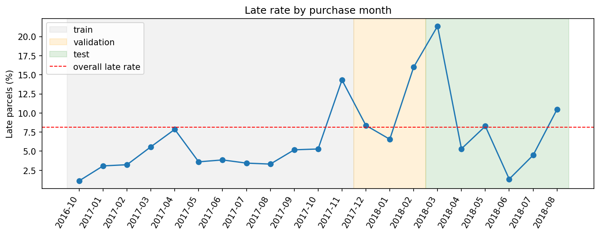
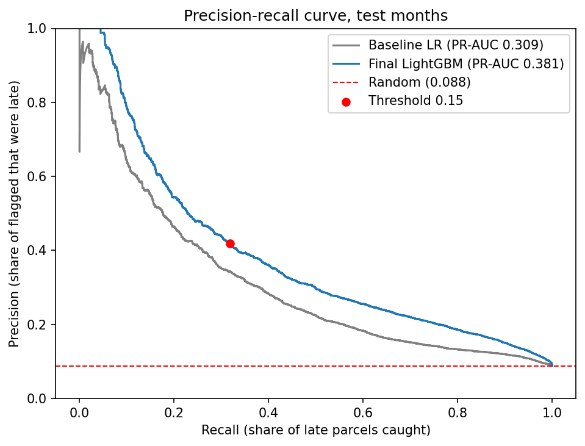
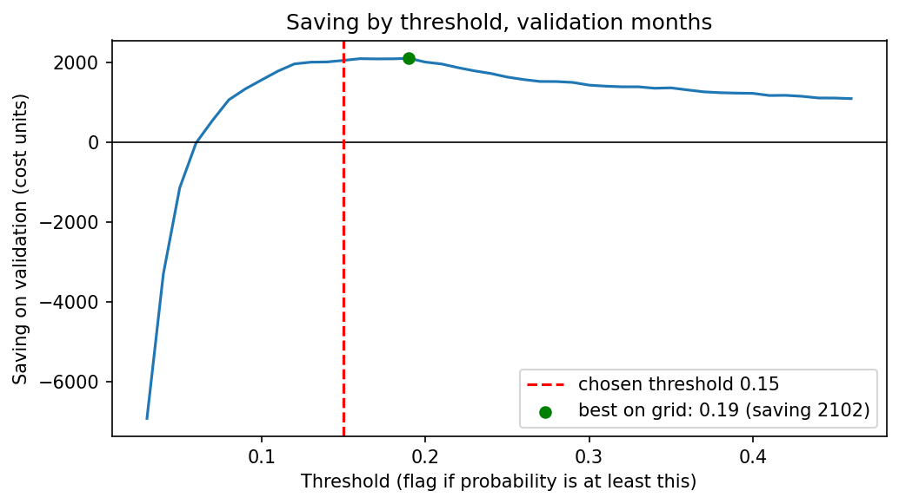

# Logistic_prediction: predicting late deliveries

Predict which parcels will arrive late **at the moment the carrier picks them up**, explain why, and suggest what operations should do about it.

Built on the public [Olist Brazilian E-Commerce dataset](https://www.kaggle.com/datasets/olistbr/brazilian-ecommerce) (about 100k orders, Sep 2016 to Aug 2018). It follows the steps like (define the problem, audit the data, baseline, better model, cost-based threshold, explanations, monitoring, tests, decision memo).

## Results at a glance

Scored on the test months (March to August 2018, 38,988 orders, 8.8% late). The test months were kept out of training and out of threshold selection.

| | Random guess | Baseline (logistic regression) | Final model (LightGBM) |
|---|---|---|---|
| PR-AUC | 0.088 | 0.309 | **0.384** |
| ROC-AUC | 0.5 | 0.743 | **0.812** |

With the decision threshold of 0.15 (chosen on a separate validation period), the final model flags 3,086 parcels (about 17 a day):

- 35.8% of the flagged parcels were really late (precision), against 8.8% when flagging at random.
- It caught 32.2% of all late parcels (recall).
- Under my assumed costs (a late parcel costs 10, a warning costs 2) this would have saved **4,868** over the 6 test months. **This assumes every warning prevents the delay.** If warnings work only half the time, the same plan loses about 652. The plan breaks even only if warnings prevent at least **56%** of the lateness.

The honest summary: the model ranks risky parcels well (about 4x better than random), but most late parcels are still missed (68% of them were rated "low risk"), and the money gain over the simple baseline is small (+8%, see below).



*The late rate swings between 1.4% and 21% from month to month. This is why the split is by time and not random.*





## How it works

1. **Label.** A parcel is late if it is delivered after the estimated delivery date shown to the customer. I rejected "more than 3 days late" (hides small delays customers still notice) and "slower than the carrier average" (not tied to any promise).
2. **Prediction moment.** When the carrier picks up the parcel. Only information known at that moment may be used.
3. **Features (19).** Promised days, days from purchase to carrier pickup, distance between seller and customer, weight, volume, price, freight, number of items, number of sellers, purchase month and weekday, product category, seller and customer state, and seller and customer coordinates. The actual delivery date, the label, IDs and order status are excluded (leakage). A test checks that none of them is a feature.
4. **Validation by time.** Train on orders before Dec 2017, tune the model and pick the threshold on Dec 2017 to Feb 2018, score the test months from March 2018.
5. **Models.** A logistic regression baseline (11 features) and a LightGBM model (19 features). LightGBM was tuned with `RandomizedSearchCV` (20 combinations, always trained on the early months and scored on the validation months, never on random folds), then retrained on all months before March 2018.
6. **Threshold.** Flagging a parcel pays off only if (probability of being late) x (late cost) is larger than the warning cost. On validation, 0.15 gave the highest saving, and the saving was flat between 0.12 and 0.20.

## Data and cleaning

The raw data is not in this repo. Download it from [Kaggle](https://www.kaggle.com/datasets/olistbr/brazilian-ecommerce) (9 CSV files). Six are used: orders, order items, products, sellers, customers and geolocation. Reviews are deliberately **not** used, because they only exist after delivery.

| Issue found | Rows | What I did |
|---|---|---|
| Orders with no customer delivery date | 2,965 (3%) | Excluded: lateness cannot be judged. 1,107 of them were shipped but never recorded as delivered, so some may be lost or very late and the real late rate may be slightly higher |
| Delivered orders with no approval time or carrier pickup date | 15 | Dropped |
| Impossible dates: carrier pickup after delivery (23) or before purchase (165) | 188 | Dropped |
| Delivered before purchase, duplicate orders | 0 | Checked, none found |
| Orders with several items (up to 21) | many | Collapsed to one row per order: summed price, freight, weight and volume, kept the first seller |
| Products with no category | 610 | Labelled "unknown" |
| Products with a weight of 0 g (impossible) | 4 | Set to missing |
| Orders left with no weight or volume | 22 and 16 | Filled with the median |
| Geolocation file: about 1M rows for 19,015 zip prefixes | n/a | Averaged to one point per zip prefix |
| Orders whose zip prefix has no coordinates | 215 seller side, 264 customer side | Left empty, the model handles missing values |
| Distance above 4,500 km (impossible in Brazil, max was 8,677 km) or no coordinates | 482 (0.5%) | Filled with the median, plus a flag column `distance_missing` |

The final modelling table has **96,273 orders**, with about 8% late.

## Where the model works worst

- **Time.** March 2018 had a 21.4% late rate. The model caught only 30.5% of those late parcels. March alone holds about 45% of all missed late parcels, and 2,644 of the 4,868 total saving. In quiet June (1.4% late) the fixed threshold lost money (-56).
- **States.** Recall is very low in RS (8%), MG (11%) and ES (16.5%). PE is over-flagged: its precision (16.5%) is under the 20% break-even, so the saving there is negative (-66). SP alone gives about 44% of the saving because of its volume.
- **Product category** is not a major weak spot: late rates are all close to the average, and the saving is positive in every category with at least 500 orders.
- Some segments have very few late parcels, so their percentages are noisy.

## Risk tiers and suggested actions

| Tier | Predicted probability | Orders | Real late rate | Suggested action | Break-even success rate* |
|---|---|---|---|---|---|
| Low | under 0.15 | 35,902 | 6.5% | None | n/a |
| Medium | 0.15 to 0.30 | 2,150 | 27.0% | Message the customer | 37% |
| High | 0.30 to 0.50 | 555 | 41.8% | Priority handling or reroute | 72% |
| Very high | 0.50 or more | 381 | 76.4% | Upgrade shipping | 65% |

## Why a parcel is flagged

Each flagged parcel gets its top reasons, taken from the model's per-feature contributions (the same quantities SHAP reports). Across the whole model, the most important features are the promised delivery time, the seller's handoff time, the customer's state, the purchase month and the customer's location. A short promise and a slow handoff raise the risk the most.

Example output of `predict.py`:

> 22.5% chance of being late, tier medium, suggested action: send the customer a proactive message. Reasons: the customer is in BA, where parcels were often late; the promised delivery time leaves little room; products in this category were often late.

These reasons are **patterns the model learned, not proven causes**. I trust the promise and handoff features the most, and `purchase_month` the least: with only 14 months of history it mostly reflects one spike (March 2018) and may not hold in another year.

## Monitoring for decay

`src/monitor.py` has a Population Stability Index (PSI) check. It compares the distribution of a feature in new data with the training data. Alert rule: PSI below 0.10 is stable, 0.10 to 0.25 means watch, above 0.25 means investigate.

On the test months, `promised_days` (0.275) and `freight` (0.282) crossed 0.25: promises got about 3 days shorter (median 24 to 21 days). The model still held up, so PSI shows that the inputs changed, not that the model got worse. The cut-offs are common rules of thumb, not tuned here.

Not implemented in code, only proposed: once real delivery dates arrive, track the weekly precision of flagged parcels. If it stays under the 20% break-even (warning cost 2 / late cost 10) with at least 50 flagged parcels, the warnings lose money and should be reviewed.

## How to run

Everything runs from the repo root.

**1. Install**

```bash
pip install -r requirements.txt
```

**2. Score new parcels**

```bash
python src/predict.py --input data/sample/new_parcels.csv --output predictions.csv
```

The input must already contain `order_id` and the 19 feature columns (see `data/sample/new_parcels.csv`). The script stops with a clear message on bad input: missing columns, empty values, non-numeric or out-of-range values, labels the model has never seen. The output has the late probability, a flag (probability of at least 0.15), the risk tier, the suggested action and the reasons for flagged parcels.

**3. Run the tests**

```bash
python -m pytest tests -q
```

Four tests: the label definition (late and on time, and a parcel delivered exactly on the promised date is not late), no leaky column among the features, and the risk-tier boundaries.

**4. Reproduce the analysis**

Open the notebook in `notebooks/` in Google Colab, upload the 9 Olist CSV files to `/content/`, and choose Runtime > Run all.

## Repo layout

```
src/          predict.py, explain.py, monitor.py, labels.py
tests/        automated tests
models/       trained model and its metadata (feature list, threshold, category labels)
data/sample/  10 example parcels in the input format
notebooks/    the full analysis
figures/      charts used in this README
FAILURES.md   every bug, surprise and wrong turn, with what I learned
decision_memo.md  recommendation for an operations head, in plain language
```

The model file is called `logistic_tracker.joblib`, but it contains the final **LightGBM** model, not the logistic regression baseline.

## Limitations

- **The trained model is specific to Olist** (Brazil, 2016 to 2018). The method is reusable (label, leakage rule, time split, cost-based threshold, monitoring), but the model must be retrained on another company's data.
- **Costs and actions are assumed**, not measured. The 4,868 saving is a best case.
- **Medians used to fill gaps were computed on the full table**, not on the training months only. Fewer than 0.6% of the rows are affected.
- **Survivorship.** Parcels with no recorded delivery are excluded, so the real late rate may be slightly higher.
- **Distance is a straight line** between zip-code centres, not the real route.
- **One order is treated as one parcel**, with the first seller. I did not measure how many orders contain several sellers, or whether some orders shipped in several boxes.
- **Estimated delivery dates may be set at midnight**, so a parcel delivered during the promised day could be counted as late. I did not measure how often this happens.
- **Only 14 months of history.** Seasonal effects cannot be separated from one-off events.
- **`predict.py` expects the 19 features already built.** There is no script that turns the raw Olist files into those features. That logic lives in the notebook.

## What is real and what is assumed

| Real (Olist data) | Assumed or invented by me |
|---|---|
| Orders, dates, products, locations, freight | Late and warning costs (10 and 2) |
| Which parcels were really late | Action costs and the claim that an action works |
| | Risk tier cut-offs (0.30, 0.50) |

## With more time

1. Add each seller's past late rate, computed only from earlier orders (leakage-safe), and recent order volume to catch busy periods like March 2018.
2. Pilot the medium tier for 4 to 6 weeks and measure how often a warning really prevents a delay.
3. Re-check the threshold regularly, because the right value depends on the current late rate.
4. Turn the rolling precision check into code, and add automated tests for input validation.

## Author

Suraj Tiwari